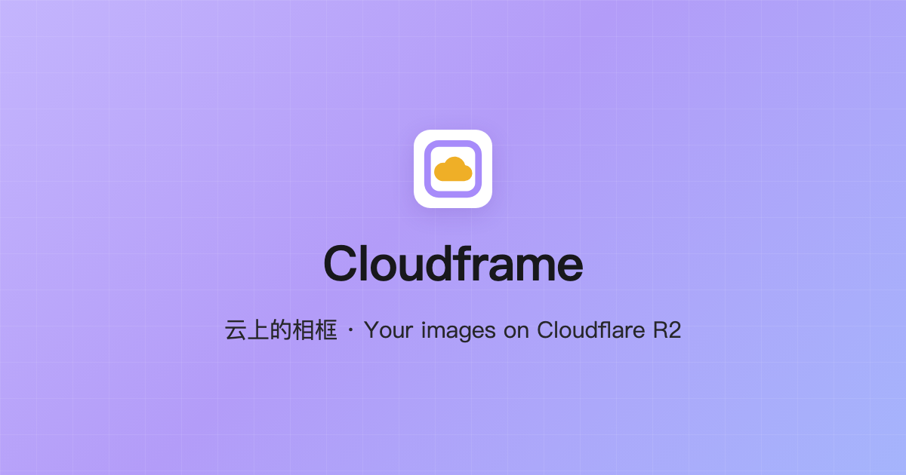

<p align="center"></p>

<p align="center"><b>English</b> · <a href="README-zh.md">简体中文</a></p>

# Cloudframe

**A frame in the cloud**: a private image-hosting panel on Cloudflare. Your images live in your own R2 bucket; the panel handles uploading and managing them, behind a single password that works on any device.

📖 **Documentation**: the illustrated [guide & tutorial](https://uncat2310.github.io/Cloudframe/) walks through deployment, uploads, the gallery, settings and security — start there if you are new.

## Why

- **One password**: R2 access stays on the server and never reaches the browser. On a new device or browser, just enter the password.
- **Free to host**: runs on Cloudflare Workers with an R2 binding, so no API token is needed. Personal use fits comfortably in the free tier.
- **No CORS setup**: the browser only talks to the panel's own origin, which talks to R2.
- **Images don't depend on the panel**: they are served straight from the bucket's public URL, so shared links keep working without it.

## Features

- **Upload**: drag and drop, paste or pick files; optional compression and conversion (WebP / AVIF / JPEG / PNG); custom key templates such as `i/{{year}}/{{month}}/{{day}}/{{ulid-dayslice}}.{{ext}}`
- **Gallery**: grid view, search by name, filter and sort by date; HEIC and Apple Live Photo support
- **Share**: copy the image URL or Markdown in one click
- **Manage**: rename, delete, download; deleted images go to a trash and can be restored for 30 days
- **Settings sync**: compression, key templates and other settings live on the server, the same on every browser and device
- **Interface**: English / 中文, light and dark themes

Key template placeholders, compression and gallery options are described in the [settings reference](docs/settings.en.md).

## Deploy

Pick one of three options; step-by-step instructions are in **[selfhost/README.md](selfhost/README.md)** (in Chinese).

| Option             | Cost                  | Needs                                       |
| ------------------ | --------------------- | ------------------------------------------- |
| Cloudflare Workers | Free for personal use | A Cloudflare account, no R2 API token       |
| Docker             | Your server           | A VPS or always-on machine, an R2 API token |
| Node               | None                  | Node.js 22, an R2 API token                 |

On Workers, in short (section 2 of the guide has every click):

1. Create an R2 bucket and enable public access (custom domain or r2.dev);
2. Fork this repo and set the bucket name and public URL in `apps/web/wrangler.jsonc`; without a domain of your own, set `workers_dev` to `true`;
3. Cloudflare dashboard → Workers & Pages → import the Git repository, with the build and deploy commands from the guide;
4. Add `CLOUDFRAME_PASSWORD` (login password) and `CLOUDFRAME_SESSION_SECRET` (a long random string) under the Worker's Variables and Secrets, **both as secrets**;
5. Attach your own domain under the Worker's Domains (e.g. `pic.example.com`) and add a login rate-limiting rule to it;
6. Open your domain and sign in.

Every push to `main` redeploys.

## Security

- Login is rate limited: 10 attempts per minute per IP and 60 per minute overall; on Workers the client IP comes from Cloudflare and cannot be forged. A Cloudflare rate-limiting rule on your domain blocks password guessing precisely.
- Sessions are signed HttpOnly, SameSite=Strict cookies valid for 30 days.
- Only images and videos can be uploaded; files read through the panel are served sandboxed, so they can never run as a page.
- Every response carries security headers (no framing, no MIME sniffing, HSTS and more).

## Development

Requires Node.js 22 and pnpm (`corepack enable`):

```bash
pnpm install
pnpm --filter cloudframe-web dev     # dev server
pnpm --filter cloudframe-web test    # tests (run in Chromium)
pnpm --filter cloudframe-web lint
```

## Contributors

- **[uncat2310](https://github.com/uncat2310)**: author and maintainer; adapted the project into a self-hosted Cloudflare R2 panel, deploys and uses it.
- **Claude** ([Anthropic](https://www.anthropic.com)'s AI assistant, via [Claude Code](https://claude.com/claude-code)): security review and hardening, dependency upgrades, the Cloudframe rename, icon and docs. Its commits carry a `Co-Authored-By: Claude` trailer.

The author and contributors of the original S3 Image Port are credited below.

## Acknowledgements

Cloudframe is built on **[S3 Image Port](https://github.com/yy4382/s3-image-port)** by [yy4382](https://github.com/yy4382) (synced past upstream v1.8.5). Uploading, the gallery, compression, HEIC and Live Photo support all come from the original project. Thank you!

Compared with it, Cloudframe only keeps the self-hosted mode and targets Cloudflare R2: browser-side S3 settings, multiple profiles, profile sync and the bundled docs site are removed, and login and uploads are hardened. Settings help now links to this repository's own docs.
